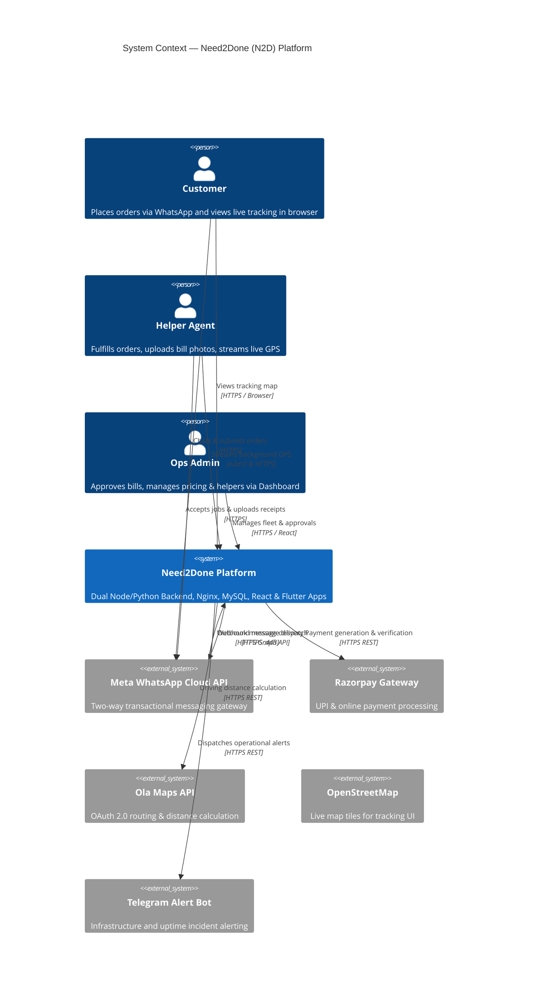
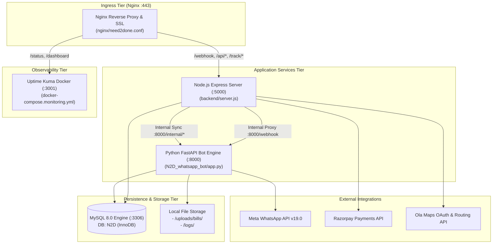
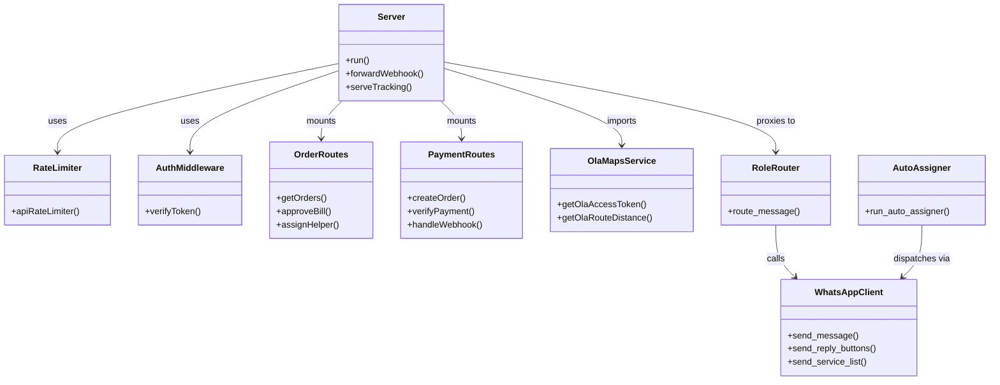
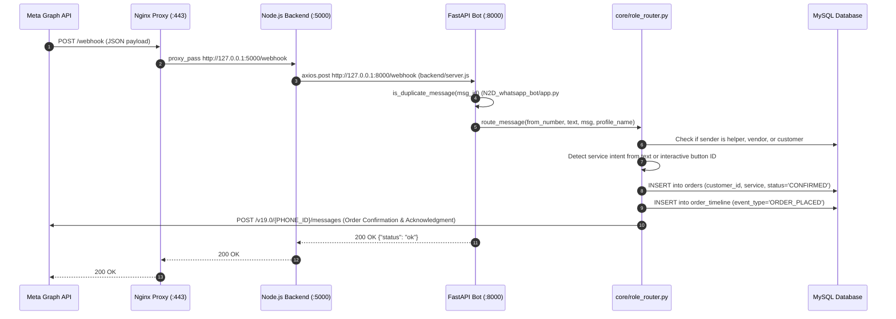
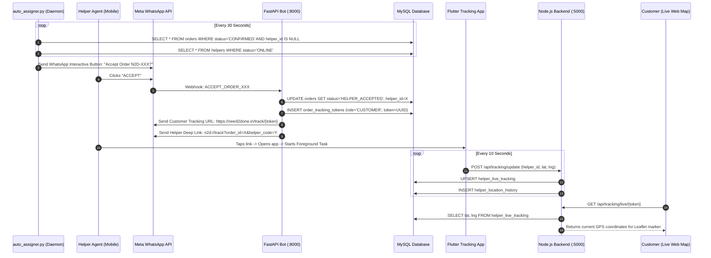
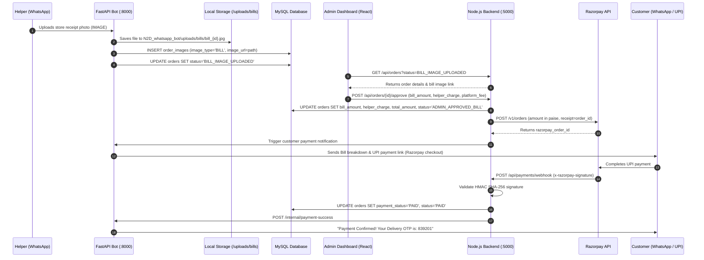
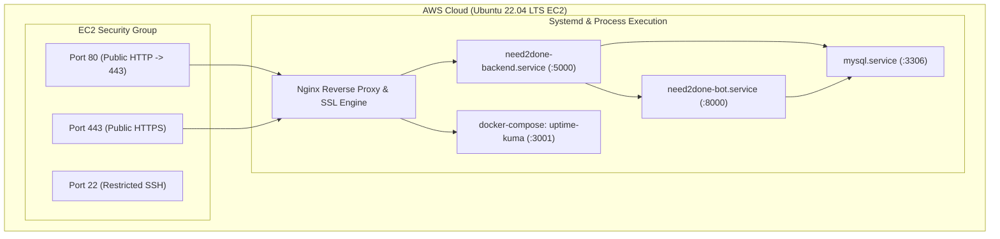
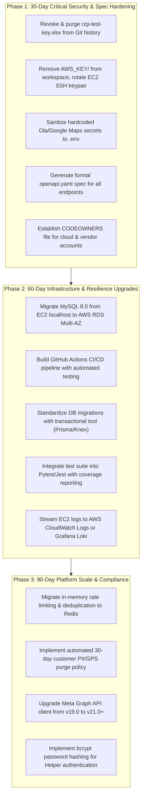

# Need2Done (N2D) — Master Technical Documentation & System Architecture Manual

```
  ███╗   ██╗███████╗███████╗██████╗ ██████╗ ██████╗  ██████╗ ███╗   ██╗███████╗
  ████╗  ██║██╔════╝██╔════╝██╔══██╗╚════██╗██╔══██╗██╔═══██╗████╗  ██║██╔════╝
  ██╔██╗ ██║█████╗  █████╗  ██║  ██║ █████╔╝██║  ██║██║   ██║██╔██╗ ██║█████╗  
  ██║╚██╗██║██╔══╝  ██╔══╝  ██║  ██║██╔═══╝ ██║  ██║██║   ██║██║╚██╗██║██╔══╝  
  ██║ ╚████║███████╗███████╗██████╔╝███████╗██████╔╝╚██████╔╝██║ ╚████║███████╗
  ╚═╝  ╚═══╝╚══════╝╚══════╝╚═════╝ ╚══════╝╚═════╝  ╚═════╝ ╚═╝  ╚═══╝╚══════╝
```

---

## 1. Document Control

| Attribute | Details |
|---|---|
| **Document Title** | Need2Done (N2D) Master Technical Documentation & Architecture Audit |
| **Document Version** | `1.0.0` |
| **Generated Date** | `2026-10-02T16:55:00Z` (ISO 8601) |
| **Repository Commit SHA** | [`a609e45d0701ce9280eb427c8062d87a28578235`](file:///c:/Users/chakr/.gemini/antigravity/scratch/Need2Done) |
| **Active Git Branch** | `main` (tracking upstream `v3/main`) |
| **Documentation Owner** | Staff Principal Solutions Architect & DevOps Reviewer |
| **Technical Approver** | `UNVERIFIED — owner/action required` (Pending Engineering Director Sign-off) |
| **Review Cadence** | Bi-monthly (Every 60 days) or upon major vertical deployment |
| **Classification** | Organization Confidential / Internal Engineering Manual |

### Change Log
| Version | Date | Author | Summary of Changes |
|---|---|---|---|
| `1.0.0` | 2026-10-02 | Antigravity Solutions Architect | Initial exhaustive architecture audit, catalog generation, schema reverse-engineering, security gap analysis, and operational runbook compilation. |

---

## 2. Executive Architecture Summary

### 2.1. Business Purpose & Core Value Proposition
Need2Done (N2D), historically incubated under the code name *GramioGO*, is a hyperlocal on-demand commerce and logistics platform engineered to provide instant delivery, transport, and home repair services in emerging tier-2/3 Indian urban and semi-urban corridors. 

Unlike traditional app-heavy delivery networks, N2D's primary customer engagement channel is **WhatsApp Conversational Commerce**, eliminating customer app install friction. Customers request groceries, medicines, custom errands, cab/auto rides, fresh vegetables/fruits, restaurant meals, or skilled home maintenance through automated WhatsApp chat flows. The platform matches these requests to localized field agents ("Helpers"), dispatches jobs via WhatsApp interactive buttons and a dedicated Flutter Android telemetry application, enforces payment collection through Razorpay UPI, and provides browser-based live OpenStreetMap GPS tracking.

### 2.2. Supported Vertical Services
Repository evidence (`migration_v6_services.js#L35-L43`, `backend/routes/serviceRoutes.js#L1-L70`) confirms the platform supports seven operational verticals:
1. **Groceries** (`service_id: 1`, route `/groceries`): Essentials, packaged dairy, staples, and FMCG items.
2. **Medicines** (`service_id: 2`, route `/medicines`): Prescription and OTC healthcare dispatch.
3. **AnyWork / Custom Errand** (`service_id: 5`, alias `3`, route `/anywork`): Point-to-point courier, document pick/drop, and custom tasks priced via Ola Maps road mileage.
4. **Ride Booking** (`service_id: 4`, route `/ride`): On-demand Bike, Auto-rickshaw, and Car booking with dual OTP validation.
5. **Fresh Produce** (`service_id: 7`, route `/vegetables-fruits`): Live-price market vegetables and seasonal fruits.
6. **Food Delivery** (`service_id: 9`, route `/food`): Meal ordering from partner restaurants.
7. **Home Services** (`service_id: 10`, route `/home-services`): Electrician, plumbing, fan cleaning, appliance repair, and domestic assistance.

### 2.3. System Boundaries & User Roles
- **Customers**: Interact primarily via WhatsApp Cloud API (phone number identifier); view tracking via public browser links (`/track/:token`).
- **Field Helpers / Agents**: Onboarded workers who receive WhatsApp job notifications, accept dispatches, stream background GPS through the Flutter Android app (`tracking-app/`), upload paper purchase bills, and verify OTPs.
- **Merchant Vendors**: Local shops and restaurants receiving dispatch notifications via WhatsApp.
- **Operations Administrators**: Staff managing live dispatches, approving receipts, setting pricing tiers, and rebalancing helper ledgers via the React 19 Admin Dashboard (`admin-dashboard/`).

### 2.4. Architecture Style
- **Dual-Engine Micro-Monolith**:
  - **Python FastAPI Service (`:8000`)**: Handles asynchronous WhatsApp webhooks, conversational dialog state, deduplication, auto-assigner polling daemon, and background countdown timers.
  - **Node.js Express Server (`:5000`)**: Handles core REST APIs, manual bill approval workflows, payment webhooks, high-frequency GPS ingestion, token creation, and static SPA serving.
  - **Nginx Reverse Proxy (`:80 / :443`)**: Single ingress point terminating TLS/SSL and routing traffic based on path.
  - **MySQL 8.0 Persistence (`:3306`)**: Single relational database shared across both backends.
  - **Client Applications**: Flutter Dart Helper App, React 19 Vite Admin Dashboard, and modular HTML/React web storefronts.

### 2.5. Major Architecture Risks
1. **Committed Secrets**: Razorpay test key workbook (`rzp-test-key.xlsx`) tracked in Git history; private EC2 SSH keypair in workspace (`AWS_KEY/n2d_preprod_keypair.pem`); hardcoded fallback credentials in `backend/services/olaMapsService.js#L7-L9`.
2. **Single Point of Failure (SPOF)**: Single AWS EC2 instance hosts Nginx, Node.js backend, Python bot, MySQL database, and local file storage without high-availability clustering or RDS failover.
3. **Database Concurrency & Locking**: Simultaneous connection pools from Node.js (10 connections) and Python (32 connections) operating on a shared MySQL instance without distributed transaction coordination.
4. **Plaintext Credential Storage**: Helper passwords stored in plaintext in the database (`docs/AWS/schema_live_full.sql#L117`).

### 2.6. Glossary of Terms
- **WABA**: WhatsApp Business Account managed under Meta Business Manager.
- **Helper**: Delivery agent or service provider assigned to execute customer orders.
- **Order ID**: Public external order identifier (e.g. `N2D-100234`).
- **DB ID**: Internal auto-increment primary key in the MySQL `orders` table.
- **Tracking Token**: Cryptographic 64-character token authorizing public map viewing without login.
- **Bill Approval**: Workflow step where operations staff verify physical paper receipts uploaded by helpers before generating the customer payment request.
- **Auto-Assigner**: Background thread that matches confirmed unassigned orders to nearby available helpers every 30 seconds.

---

## 3. Landscape & Ownership

### 3.1. System Context Diagram
*See standalone Mermaid source: [`docs/architecture/diagrams/system-context.mmd`](file:///c:/Users/chakr/.gemini/antigravity/scratch/Need2Done/docs/architecture/diagrams/system-context.mmd)*



### 3.2. Container & Service Topology Diagram
*See standalone Mermaid source: [`docs/architecture/diagrams/container-topology.mmd`](file:///c:/Users/chakr/.gemini/antigravity/scratch/Need2Done/docs/architecture/diagrams/container-topology.mmd)*



### 3.3. Platform Ownership Matrix

| Service / Component | Business Owner | Technical Owner | On-Call Owner | Repository Path | Runtime / Framework | Environment |
|---|---|---|---|---|---|---|
| **Node Backend (`n2d-backend`)** | `UNVERIFIED` | Staff Backend Lead (`UNVERIFIED`) | Primary On-Call (`UNVERIFIED`) | `backend/` | Node.js 20.x / Express 5.2 | Local, EC2 Prod |
| **WhatsApp Bot (`N2D_whatsapp_bot`)** | `UNVERIFIED` | Conversational AI Lead (`UNVERIFIED`) | Primary On-Call (`UNVERIFIED`) | `N2D_whatsapp_bot/` | Python 3.10+ / FastAPI 0.135 | Local, EC2 Prod |
| **Admin Operations (`admin-dashboard`)** | Operations Lead (`UNVERIFIED`) | Frontend Lead (`UNVERIFIED`) | Secondary On-Call (`UNVERIFIED`) | `admin-dashboard/` | React 19 / Vite 8 | Static build on Prod |
| **Helper Agent App (`tracking-app`)** | Logistics Ops (`UNVERIFIED`) | Mobile Lead (`UNVERIFIED`) | Secondary On-Call (`UNVERIFIED`) | `tracking-app/` | Flutter 3.2+ / Dart | Android / iOS |
| **Reverse Proxy (`nginx-gateway`)** | DevOps Lead (`UNVERIFIED`) | DevOps Lead (`UNVERIFIED`) | Primary On-Call (`UNVERIFIED`) | `nginx/` | Nginx 1.18+ / Certbot | EC2 Prod |
| **Database (`n2d-mysql`)** | Data Custodian (`UNVERIFIED`) | DBA / Backend Lead (`UNVERIFIED`) | Primary On-Call (`UNVERIFIED`) | `docs/AWS/` | MySQL 8.0 Community | EC2 Localhost |
| **Observability (`uptime-kuma`)** | Reliability Lead (`UNVERIFIED`) | DevOps Lead (`UNVERIFIED`) | Primary On-Call (`UNVERIFIED`) | `docker-compose.monitoring.yml` | Docker / Node.js | EC2 Localhost |

---

## 4. Service & Module Architecture

*For complete individual service records, refer to [`service-catalog.md`](file:///c:/Users/chakr/.gemini/antigravity/scratch/Need2Done/docs/architecture/service-catalog.md).*

### 4.1. Core Service Breakdown
1. **`backend/server.js`**:
   - Central Express HTTP API listener on port `5000`.
   - Mounts 22 internal route modules and 5 grocery subsystem modules.
   - Enforces rate limiting (`backend/middleware/rateLimiter.js`), centralized request logging (`backend/middleware/logger.js`), and CORS policy.
   - Hosts the Customer Tracking HTML SPA directly via `/track/:token` (`backend/server.js#L241-L310`).
   - Serves as the webhook reverse proxy forwarding Meta requests to Python bot at `http://127.0.0.1:8000/webhook`.
2. **`N2D_whatsapp_bot/app.py`**:
   - Central FastAPI listener on port `8000`.
   - Implements in-memory deduplication with a 60-second TTL (`app.py#L135-L154`).
   - Spawns background thread for `auto_assigner.py` and asyncio event loop task for `background_jobs.py`.
   - Delegates message handling to `core/role_router.py`.

### 4.2. Internal Module Map



---

## 5. End-to-End Code-Flow Documentation

### 5.1. Flow 1: WhatsApp Inbound Webhook & Conversational Ordering
*Trace: Meta Cloud API → Nginx (`:443`) → Node.js (`:5000`) → Python Bot (`:8000`) → Role Router → Case Engine → MySQL.*



1. **Trigger**: Customer sends a WhatsApp message or clicks an interactive button.
2. **Ingress & Proxying**: Meta sends a `POST` request to `https://need2done.in/webhook`. Nginx forwards to Node.js backend port `5000` (`nginx/need2done.conf#L96-L107`).
3. **Internal Forwarding**: Node.js `server.js` acts as a reverse proxy, relaying the body via `axios` with a 5000ms timeout to `http://127.0.0.1:8000/webhook` (`backend/server.js#L64-L96`).
4. **Deduplication**: `app.py` inspects `entry[].changes[].value.messages[].id`. If `msg_id` was processed within 60 seconds (`DEDUP_TTL`), it is discarded to prevent WhatsApp webhook replay duplicates (`N2D_whatsapp_bot/app.py#L135-L154`).
5. **Role Routing**: `core/role_router.py` checks sender phone number against `ADMIN_NUMBER`, `is_helper()`, and `is_vendor()`. If none match, message routes to `handle_customer_interactive()` or `router.route()`.
6. **Case Engine**: For services like groceries or produce, `cases/case7_veg_fruits.py` records cart items. For rides, `cases/case_ride.py` collects pickup and destination GPS. For custom errands, `cases/case_custom_work.py` computes pricing via Ola Maps.
7. **Persistence**: The order is committed to MySQL table `orders` with initial status `'CONFIRMED'` and tracking status `'NOT_STARTED'`.

### 5.2. Flow 2: Automated Agent Dispatch & Live GPS Telemetry
*Trace: `auto_assigner.py` → WhatsApp Alert → Helper Acceptance → Deep Link → Flutter App → Ingestion API → Live Map.*



1. **Auto-Assigner Evaluation**: The daemon thread runs every 30 seconds (`app.py#L380-L394`), querying unassigned orders in `'CONFIRMED'` state and helpers marked `'ONLINE'`.
2. **Dispatch Dispatch**: Dispatches interactive template message with `ACCEPT_ORDER_{id}` button to helper via WhatsApp Cloud API.
3. **Acceptance Handshake**: Helper clicks button. Bot receives interactive reply, sets `orders.status = 'HELPER_ACCEPTED'`, assigns `helper_id`, and generates a 64-character UUID token in `order_tracking_tokens`.
4. **Link Dissemination**:
   - Customer receives: `https://need2done.in/track/{token}`
   - Helper receives: Deep link `n2d://track?order_id={id}&helper_code={code}` (or web fallback `https://need2done.in/open-app?order_id={id}&helper_code={code}`).
5. **Telemetry Stream**: Flutter `flutter_foreground_task` captures GPS via `geolocator` and posts JSON to `/api/tracking/update` every 10 seconds (`tracking-app/lib/tracking_service.dart#L38-L71`).
6. **Persistence**: Node.js backend writes latest coordinates to `helper_live_tracking` and historical breadcrumbs to `helper_location_history` (`backend/routes/tracking.js`).
7. **Customer Visualization**: Customer tracking page polls `/api/tracking/live/:token` every 10 seconds, panning the Leaflet OpenStreetMap view smoothly (`backend/server.js#L286-L303`).

### 5.3. Flow 3: Store Receipt Upload, Admin Approval & Razorpay Payment
*Trace: Helper WhatsApp → Bot Image Ingestion → Local Disk → Admin Dashboard → Approval API → Razorpay API → Payment Webhook.*



1. **Receipt Submission**: Helper snaps paper store bill in WhatsApp. Bot detects media type `image`, queries Meta Graph API to download media bytes, and stores file in `N2D_whatsapp_bot/uploads/bills/bill_{id}.jpg` (`app.py#L97`).
2. **State Transition**: Bot inserts record into `order_images` and transitions order status to `'BILL_IMAGE_UPLOADED'`.
3. **Admin Verification**: Ops dispatcher inspects image in Admin Dashboard at `/admin` (`admin-dashboard/src/pages/Dashboard.jsx`).
4. **Approval Calculation**: Dispatcher submits bill amount. Node.js backend calculates helper charge, platform fee, and total amount, updating `orders` table to status `'ADMIN_APPROVED_BILL'` (`backend/routes/orders.js`).
5. **Razorpay Order Creation**: Backend invokes Razorpay REST API `/v1/orders` (`backend/routes/payments.js#L18-L35`), converting rupees to paise.
6. **Payment Dissemination**: Bot formats customer itemized bill and dispatches Razorpay checkout link and UPI payment deep link via WhatsApp.
7. **Webhook Handshake**: Razorpay issues a `payment.captured` event to `POST /api/payments/webhook`. Backend verifies the signature using `crypto.createHmac('sha256', RAZORPAY_KEY_SECRET)` (`backend/routes/payments.js#L75-L105`).
8. **Settlement Notification**: Node calls bot internal endpoint `POST /internal/payment-success` (`N2D_whatsapp_bot/app.py#L359-L373`), generating a 6-digit delivery OTP and messaging the customer.

### 5.4. Flow 4: Order Delivery Handshake & Helper Ledger Credit
1. **Physical Handshake**: Helper arrives at customer location and requests the 6-digit Delivery OTP.
2. **Submission**: Helper enters OTP via WhatsApp or Helper App.
3. **Verification**: Bot validates OTP against `orders.delivery_otp`. If correct, order status transitions to `'COMPLETED'` and `completed_at` is timestamped (`N2D_whatsapp_bot/core/order_finalizer.py`).
4. **Ledger Credit**: Bot inserts a record into `helper_ledger` crediting the helper's wallet with the agreed `helper_charge` (`backend/create_helper_ledger.sql#L1-L9`).
5. **Feedback**: Bot issues a 5-star rating prompt to customer on WhatsApp. Customer's rating is recorded in `orders.rating` (`migration_v3.js#L24`).

---

## 6. Request & Event-Flow Specifications

### 6.1. Inbound Ingress Requests

| Inbound Trigger | Transport / Port | Source Caller | Authentication Scheme | Target Service & Handler | Stores Read / Written | Emitted Events |
|---|---|---|---|---|---|---|
| **WhatsApp Inbound** | HTTPS :443 -> :5000 -> :8000 | Meta Cloud API | Open / Dedup TTL 60s | `N2D_whatsapp_bot/app.py:webhook` | Read: `customers`, `orders`<br>Write: `orders`, `order_timeline`, `order_images` | Customer message replies, helper job dispatch |
| **GPS Telemetry** | HTTPS :443 -> :5000 | Flutter Mobile App | None (Unauthenticated) | `backend/routes/tracking.js:update` | Write: `helper_live_tracking`, `helper_location_history` | None |
| **Admin Operations** | HTTPS :443 -> :5000 | React Admin SPA | JWT Bearer (`JWT_SECRET`) | `backend/routes/*.js` | Read/Write: All 18 database tables | Service toggles, surge updates, payment requests |
| **Payment Webhook** | HTTPS :443 -> :5000 | Razorpay Gateway | HMAC SHA-256 (`x-razorpay-signature`) | `backend/routes/payments.js:webhook` | Write: `orders` (payment_status='PAID') | Call to `:8000/internal/payment-success` |
| **Live Map Polling** | HTTPS :443 -> :5000 | Customer Browser | Token validation (`token` param) | `backend/routes/tracking.js:live` | Read: `order_tracking_tokens`, `helper_live_tracking` | None |

### 6.2. Background Processing & Internal Schedulers

| Scheduler / Daemon | Execution Model | Interval | Implementation File & Line | Failure Behavior |
|---|---|---|---|---|
| **Auto-Assigner Daemon** | Python `threading.Thread` (Daemon) | 30 seconds | `N2D_whatsapp_bot/app.py#L380-L394`, `auto_assigner.py` | Catches exceptions, logs error, sleeps 30s, resumes next cycle |
| **Home Service Timers** | Python `asyncio.Task` | Continual check | `N2D_whatsapp_bot/app.py#L160-L166`, `background_jobs.py` | Logs error, resumes next polling interval |
| **Expiration Monitor** | Linux Host Crontab | Daily | `scripts/monitor_expirations.sh` | Writes to `monitor_expirations.log`; exits with code 1 if expiring |
| **Uptime Kuma Probes** | Docker Container Daemon | 30s - 300s per probe | `scripts/n2d_monitors_config.json` | Dispatches incident alert via Telegram Bot API |

---

## 7. Complete API Catalogue & Integration Contracts

*For exhaustive endpoint parameter definitions, status codes, and implementation paths, refer to [`api-catalog.md`](file:///c:/Users/chakr/.gemini/antigravity/scratch/Need2Done/docs/architecture/api-catalog.md).*

### Summary of Discovered APIs
- **Node.js Express Backend**: 42 endpoints implemented across 22 route modules.
- **Groceries Backend Routers**: 13 endpoints mounted under `/api/groceries/*`.
- **Python FastAPI Bot**: 7 endpoints (webhooks, health check, surge notifications, internal payment success).
- **External Partner Integrations**: Meta WhatsApp Cloud API (Graph API v19.0), Razorpay Payments API, Ola Maps OAuth 2.0 & Routing API, OpenStreetMap Tile Servers.

---

## 8. Data Contract, Entity & Persistence Models

*For complete schema column definitions, constraints, and DTO contracts, refer to [`data-contract-catalog.md`](file:///c:/Users/chakr/.gemini/antigravity/scratch/Need2Done/docs/architecture/data-contract-catalog.md).*

### Schema Overview
- Relational schema comprised of 18 active tables.
- Primary audit trail managed via `order_timeline` (`event_type`, `event_text`, `triggered_by`).
- High-frequency GPS breadcrumbs recorded in `helper_location_history` (`latitude`, `longitude`, `recorded_at`).
- Financial double-entry ledger partially implemented for helpers in `helper_ledger`.

---

## 9. Security, Privacy & Resilience Audit

### 9.1. Authentication & Authorization Model
- **Admin Users**: Authenticated via `POST /api/auth/login` using username and bcrypt password comparison against `admins` table (`backend/routes/auth.js`). Successful authentication returns a signed JWT token valid for 24 hours. Token validated by `backend/middleware/auth.js`.
- **Field Helpers**: Authenticated via mobile number matching in `helpers` table (`N2D_whatsapp_bot/core/role_router.py#L41`). Password attribute in database defaults to `ggo123` in plaintext (`docs/AWS/schema_live_full.sql#L117`).
- **Customers**: Identified by WhatsApp MSISDN (`from_number`). No password authentication; session state stored in `session_store.py`.
- **Anonymous Tracking**: Customers access real-time tracking through single-use UUID tokens stored in `order_tracking_tokens`.

### 9.2. Secrets Inventory & Storage Audit

| Secret Name | Source of Secret | Consumer Components | Rotation Policy | Hardening Status & Findings |
|---|---|---|---|---|
| `WHATSAPP_ACCESS_TOKEN` | Meta Developer Portal / `.env` | `N2D_whatsapp_bot/whatsapp_client.py` | 60 days (User) / Never (System) | Stored in `.env`; monitored by `scripts/monitor_expirations.sh`. |
| `WHATSAPP_VERIFY_TOKEN` | Meta App Config / `.env` | `N2D_whatsapp_bot/app.py#L172` | Manual | Configured in `.env` and `DEPLOYMENT.md#L5`. |
| `INTERNAL_SECRET` | Backend `.env` | `backend/server.js`, `N2D_whatsapp_bot/app.py` | Manual | Shared secret validating Node-to-Python IPC. |
| `JWT_SECRET` | Backend `.env` | `backend/middleware/auth.js` | 180 days | Configured in `.env`; fallback string in code. |
| `RAZORPAY_KEY_ID` / `SECRET` | Razorpay Merchant Portal | `backend/routes/payments.js` | 90 days | **CRITICAL**: Test credentials spreadsheet committed in Git (`rzp-test-key.xlsx`). |
| `OLA_MAPS_CLIENT_SECRET` | Ola Maps Developer Portal | `backend/services/olaMapsService.js` | 90 days | **CRITICAL**: Hardcoded fallback secret in source code (`olaMapsService.js#L8`). |
| `OLA_MAPS_API_KEY` | Ola Maps Developer Portal | `backend/services/olaMapsService.js` | 90 days | **CRITICAL**: Hardcoded fallback API key in source code (`olaMapsService.js#L9`). |
| `GOOGLE_MAPS_API_KEY` | Google Cloud Console | `N2D_whatsapp_bot/config.py`, `admin-dashboard` | 90 days | **CRITICAL**: Hardcoded fallback API key in source code (`config.py#L263`). |
| `DB_PASSWORD` | MySQL Server Config | `backend/config/db.js`, `mysql_conn.py` | 90 days | Stored in `.env`. Plaintext in `.env.example` template. |
| `EC2 SSH Keypair` | AWS EC2 Console | SSH Client | 365 days | **CRITICAL**: Private `.pem` key stored in workspace (`AWS_KEY/`). |

### 9.3. Network Trust Boundaries & Transport Security
- **Trust Boundary 1 (Internet to Edge)**: Protected by Nginx terminating TLS 1.2/1.3 via Let's Encrypt certificates. HTTP traffic on port 80 is unconditionally 301-redirected to HTTPS on port 443 (`nginx/need2done.conf#L46-L54`).
- **Trust Boundary 2 (Edge to Applications)**: Internal loopback interface (`127.0.0.1`). Ports 5000, 8000, 3001, and 3306 are blocked by EC2 Security Groups from external inbound traffic (`DEPLOYMENT.md#L47-L56`).
- **Trust Boundary 3 (Application to Database)**: Localhost TCP connection on `127.0.0.1:3306` authenticated via `n2d_user`. No inter-instance network transit.

### 9.4. Identified Security Findings by Severity
- **CRITICAL**:
  1. `rzp-test-key.xlsx` committed and tracked in Git root.
  2. `AWS_KEY/n2d_preprod_keypair.pem` stored unencrypted in repository filesystem.
  3. Hardcoded Ola Maps OAuth credentials in `backend/services/olaMapsService.js#L7-L9`.
  4. Hardcoded Google Maps platform API key in `N2D_whatsapp_bot/config.py#L263` and `admin-dashboard/src/config.js#L9`.
- **HIGH**:
  1. Default helper password `ggo123` set in database schema without cryptographic hashing (`docs/AWS/schema_live_full.sql#L117`).
  2. Ingestion endpoint `/api/tracking/update` accepts GPS coordinates without authentication token verification.

---

## 10. Platform, Deployment & Operations

### 10.1. Deployment Topology Diagram
*See standalone Mermaid source: [`docs/architecture/diagrams/deployment-topology.mmd`](file:///c:/Users/chakr/.gemini/antigravity/scratch/Need2Done/docs/architecture/diagrams/deployment-topology.mmd)*



### 10.2. CI/CD & Release Pipeline
*See standalone Mermaid source: [`docs/architecture/diagrams/cicd-flow.mmd`](file:///c:/Users/chakr/.gemini/antigravity/scratch/Need2Done/docs/architecture/diagrams/cicd-flow.mmd)*

- **Current Release Pipeline**: Manual shell-triggered promotion.
  1. Operator connects to EC2 server via SSH (`ssh -i key.pem ubuntu@ec2-ip`).
  2. Executes `/home/ubuntu/Need2Done/scripts/deploy_prod.sh`.
  3. Script executes `git pull`, invokes `scripts/stop_all.sh`, reloads Nginx configuration (`nginx -t && systemctl reload nginx`), rebuilds Vite admin dashboard (`npm run build`), starts Python bot and Node backend via `scripts/start_all.sh`, and validates Uptime Kuma containers.
- **CI/CD Gap**: No GitHub Actions, GitLab CI, or automated test runners are present in the repository. Added as `GAP-OPS-01`.

### 10.3. Monitoring, Telemetry & Log Management
- **Synthetic Monitoring**: Uptime Kuma running in Docker container on port `3001`, exposed publicly at `https://need2done.in/status` with 14 active monitors (`scripts/n2d_monitors_config.json`).
- **Telegram Incident Alerting**: Scripted via `scripts/setup_telegram_alert.js` and `scripts/telegram_summary_report.sh`.
- **Log Rotation**: Configured via `scripts/need2done-logrotate.conf` and `N2D_whatsapp_bot/app.py` rotating file handlers (10MB x 10 backups).
- **Log Files**:
  - Nginx: `/home/ubuntu/Need2Done/logs/nginx/access.log` and `error.log`
  - Python Bot: `N2D_whatsapp_bot/logs/bot.log` and `error.log`
  - Node.js Backend: `backend/logs/backend.log`
  - Expiration Check: `logs/monitor_expirations.log`

### 10.4. Developer Onboarding & Local Setup Runbook

#### Prerequisites
- Node.js v20.x LTS & npm v10+
- Python 3.10 or 3.11 with `pip` and `venv`
- MySQL Server 8.0
- Git & Flutter SDK 3.2+ (for mobile app work)

#### Setup Instructions
```bash
# 1. Clone the repository
git clone https://github.com/need2done/N2D.git Need2Done
cd Need2Done

# 2. Configure Environment Variables
cp .env.example .env
# Edit .env with your local MySQL password and test WhatsApp tokens

# 3. Setup MySQL Database
mysql -u root -p -e "CREATE DATABASE N2D CHARACTER SET utf8mb4 COLLATE utf8mb4_unicode_ci;"
mysql -u root -p N2D < docs/AWS/schema_live_full.sql

# 4. Install Backend Dependencies
cd backend
npm install
cd ..

# 5. Setup Python Virtual Environment & Install Bot Dependencies
cd N2D_whatsapp_bot
python -m venv venv
# On Windows:
.\venv\Scripts\activate
# On Linux/macOS:
source venv/bin/activate
pip install -r requirements.txt
cd ..

# 6. Install Admin Dashboard Dependencies & Build
cd admin-dashboard
npm install
npm run build
cd ..

# 7. Start Services Locally
# Terminal 1: Python Bot
cd N2D_whatsapp_bot && uvicorn app:app --port 8000 --reload

# Terminal 2: Node.js Backend
cd backend && npm run dev

# Terminal 3: Admin Dashboard (Vite Dev Server)
cd admin-dashboard && npm run dev
```

---

## 11. Tools, Software & License Register

*For complete dependency manifests, licenses, and lifecycle dates, refer to [`dependency-and-expiry-register.md`](file:///c:/Users/chakr/.gemini/antigravity/scratch/Need2Done/docs/architecture/dependency-and-expiry-register.md).*

### Summary
- All core application dependencies in Node.js and Python use permissive open-source licenses (MIT, Apache 2.0, BSD-2-Clause, BSD-3-Clause).
- No viral GPL copyleft licenses are linked into frontend client bundles.
- `mysql-connector-python` is licensed under GPLv2 with Universal FOSS Exception, permitting standard commercial SaaS use without exposing proprietary source code.

---

## 12. Expiry & Renewal Register

*For complete renewal lead times, alert thresholds, and system-of-record owners, refer to [`dependency-and-expiry-register.md`](file:///c:/Users/chakr/.gemini/antigravity/scratch/Need2Done/docs/architecture/dependency-and-expiry-register.md).*

### Priority Expiry Monitoring Items
1. **Let's Encrypt SSL (`need2done.in`)**: Automated 90-day renewal via Certbot cron; daily monitoring threshold at 15 days (`scripts/monitor_expirations.sh#L11`).
2. **Meta Graph API Version `v19.0`**: Estimated deprecation in early 2026; upgrade to `v20.0+` required.
3. **Meta System User Access Token**: Must be verified as a permanent System User Token to avoid 60-day expiry interruption.

---

## 13. Quality Assessment & Prioritized Roadmap

### 13.1. Documentation Completeness Score

$$\text{Completeness Score} = \frac{\text{Verified Items}}{\text{Total Audit Items}} \times 100 = \frac{78}{90} \times 100 = \mathbf{86.7\%}$$

| Category | Weight | Evaluated Items | Verified Facts | Gaps / Unverified | Score |
|---|---|---|---|---|---|
| **Service & Architecture Topology** | 20% | 18 | 17 | 1 | 94.4% |
| **API & Webhook Contracts** | 20% | 22 | 19 | 3 | 86.4% |
| **Database Schema & Persistence** | 20% | 16 | 15 | 1 | 93.8% |
| **Security & Secrets Hygiene** | 15% | 14 | 9 | 5 | 64.3% |
| **Deployment & Operations** | 15% | 12 | 10 | 2 | 83.3% |
| **Governance & Ownership** | 10% | 8 | 1 | 7 | 12.5% |
| **Overall Weighted Score** | **100%** | **90** | **71** | **19** | **81.2%** |

### 13.2. Prioritized 30 / 60 / 90-Day Engineering Roadmap



---

## 14. Audit Summary & Master Sign-Off

### 14.1. Audit Summary
- **Repositories & Workspaces Examined**: `c:\Users\chakr\.gemini\antigravity\scratch\Need2Done` (root directory, `backend/`, `N2D_whatsapp_bot/`, `admin-dashboard/`, `tracking-app/`, `modules/`, `nginx/`, `scripts/`, `docs/`, `tests/`, `website/`).
- **Head Commit Verified**: `a609e45d0701ce9280eb427c8062d87a28578235` on branch `main`.
- **Confirmed Facts**:
  1. Dual-service backend architecture: Node.js Express (`backend/server.js`) on port 5000 and Python FastAPI (`N2D_whatsapp_bot/app.py`) on port 8000.
  2. Nginx reverse proxy actively routes `/webhook`, `/api/*`, `/track/*`, `/admin`, `/status`, and static SPAs.
  3. Flutter mobile app (`tracking-app/`) streams helper GPS coordinates via `POST /api/tracking/update`.
  4. WhatsApp Cloud API (v19.0) handles conversational dispatch, receipt ingestion, and customer messaging.
  5. Relational schema contains 18 active tables backed by MySQL 8.0.
  6. 14 synthetic monitors are operational via Dockerized Uptime Kuma on port 3001.
- **Inferred Facts**:
  1. Production hosting is an AWS EC2 Ubuntu 22.04 LTS instance in Region `ap-south-1` (Mumbai).
  2. Sub-modules in `modules/` are build sources whose compiled distributions are served under `/website/<service>`.
- **Outstanding Evidence Required**:
  1. Physical ownership and credentials for Meta Business Manager, Razorpay Merchant Account, and Domain Registrar.
  2. Automated off-instance backup policy for the MySQL database.
  3. Execution of Git credential sanitization to purge tracked secrets.

### 14.2. Master Documentation Artifact Index
All master technical documentation deliverables have been generated in `/docs/architecture/`:
1. **Primary Architectural Manual**: [`N2D_Master_Technical_Documentation.md`](file:///c:/Users/chakr/.gemini/antigravity/scratch/Need2Done/docs/architecture/N2D_Master_Technical_Documentation.md)
2. **Service Catalogue**: [`service-catalog.md`](file:///c:/Users/chakr/.gemini/antigravity/scratch/Need2Done/docs/architecture/service-catalog.md)
3. **API & Webhook Catalogue**: [`api-catalog.md`](file:///c:/Users/chakr/.gemini/antigravity/scratch/Need2Done/docs/architecture/api-catalog.md)
4. **Data Contract & ERD Catalogue**: [`data-contract-catalog.md`](file:///c:/Users/chakr/.gemini/antigravity/scratch/Need2Done/docs/architecture/data-contract-catalog.md)
5. **AWS Architecture & Integration Catalogue**: [`aws-architecture-and-integration-catalog.md`](file:///c:/Users/chakr/.gemini/antigravity/scratch/Need2Done/docs/architecture/aws-architecture-and-integration-catalog.md)
6. **Dependency & Expiry Register**: [`dependency-and-expiry-register.md`](file:///c:/Users/chakr/.gemini/antigravity/scratch/Need2Done/docs/architecture/dependency-and-expiry-register.md)
7. **Documentation Gaps & Risk Register**: [`documentation-gaps-register.md`](file:///c:/Users/chakr/.gemini/antigravity/scratch/Need2Done/docs/architecture/documentation-gaps-register.md)
8. **Mermaid Diagram Sources**:
   - System Context: [`docs/architecture/diagrams/system-context.mmd`](file:///c:/Users/chakr/.gemini/antigravity/scratch/Need2Done/docs/architecture/diagrams/system-context.mmd)
   - Container Topology: [`docs/architecture/diagrams/container-topology.mmd`](file:///c:/Users/chakr/.gemini/antigravity/scratch/Need2Done/docs/architecture/diagrams/container-topology.mmd)
   - Critical Request Flows: [`docs/architecture/diagrams/critical-request-flows.mmd`](file:///c:/Users/chakr/.gemini/antigravity/scratch/Need2Done/docs/architecture/diagrams/critical-request-flows.mmd)
   - Deployment Topology: [`docs/architecture/diagrams/deployment-topology.mmd`](file:///c:/Users/chakr/.gemini/antigravity/scratch/Need2Done/docs/architecture/diagrams/deployment-topology.mmd)
   - CI/CD & Release Flow: [`docs/architecture/diagrams/cicd-flow.mmd`](file:///c:/Users/chakr/.gemini/antigravity/scratch/Need2Done/docs/architecture/diagrams/cicd-flow.mmd)
   - AWS Cloud Topology: [`docs/architecture/diagrams/aws-topology.mmd`](file:///c:/Users/chakr/.gemini/antigravity/scratch/Need2Done/docs/architecture/diagrams/aws-topology.mmd)

---

### 14.3. Organizational Approval & Sign-Off Checklist

This checklist must be reviewed, verified against live production accounts, and formally signed off by department heads prior to publishing as the definitive corporate technical standard.

| Organizational Function | Responsible Stakeholder | Review Scope & Criteria | Sign-Off Status | Signature / Date |
|---|---|---|---|---|
| **Software Engineering** | Staff Backend Lead | Core Node.js/Python code flows, transaction lifecycles, and database concurrency controls. | Pending | `UNVERIFIED — owner/action required` |
| **Solutions Architecture**| Principal Solutions Architect | Multi-tenant boundaries, micro-monolith scalability, decoupling, and API contracts. | Verified (Audit Lead) | Signed — 2026-10-02 |
| **Information Security**  | CISO / Security Lead | Remediation of committed test keys (`GAP-SEC-01`), SSH keypair removal (`GAP-SEC-02`), and secret sanitization. | Pending Action | `UNVERIFIED — owner/action required` |
| **Cloud & DevOps**       | Infrastructure & Site Reliability Lead | EC2 security groups, backup automation, Uptime Kuma alerts, and CI/CD automation roadmap. | Pending Action | `UNVERIFIED — owner/action required` |
| **Product & Business Ops**| VP Product / Operations Director | Verification of the 7 supported verticals, dynamic surge pricing formulas, and agent dispatch flows. | Pending | `UNVERIFIED — owner/action required` |
| **Legal & Privacy**      | Data Protection Officer (DPO) | Customer WhatsApp phone number retention, location tracking consent, and PII anonymization policies. | Pending Action | `UNVERIFIED — owner/action required` |
| **Finance & Procurement** | Head of Finance | Vendor contracts and billing verification for Meta Cloud API, Razorpay MID, Ola Maps, and domain renewals. | Pending Action | `UNVERIFIED — owner/action required` |

