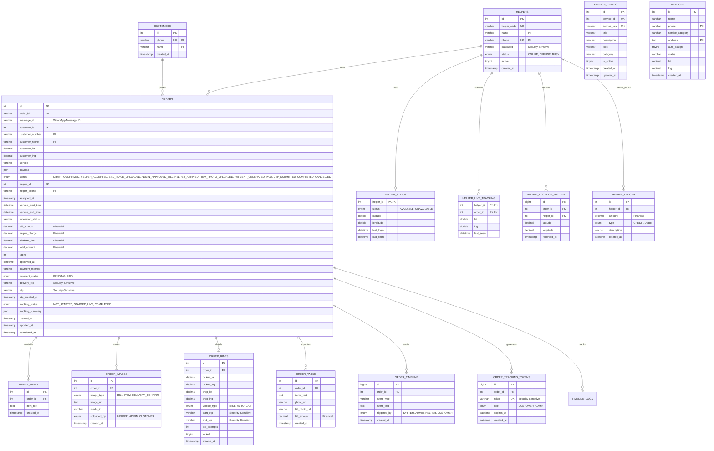
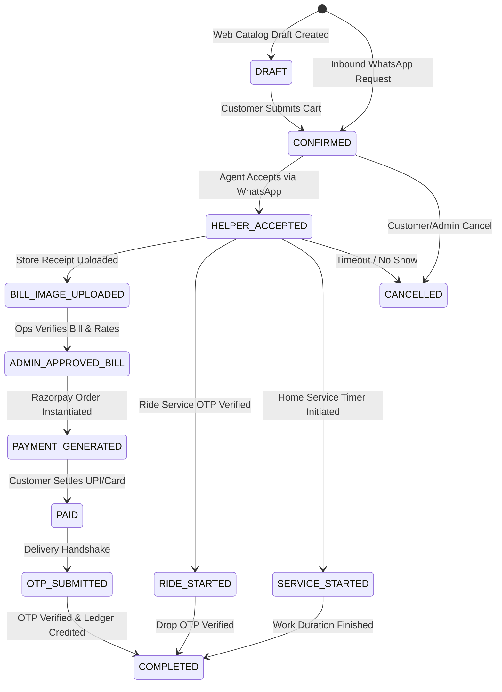

# Need2Done (N2D) — Data Contract, Schema & Persistence Catalogue

| Document Version | Status | Generated Date | Commit SHA | Classification |
|---|---|---|---|---|
| 1.0.0 | Verified from Repository | 2026-10-02 | `a609e45d0701ce9280eb427c8062d87a28578235` | Organization Confidential |

---

## 1. Persistence Engine & Migration Architecture

- **Database Engine**: MySQL Server 8.0 (`DEPLOYMENT.md#L81-L93`)
- **Default Database Name**: `N2D` (Collation: `utf8mb4_unicode_ci`, Character Set: `utf8mb4`)
- **Active Connection Pools**:
  - Node.js Backend: `mysql2` Promise pool with `connectionLimit: 10` (`backend/config/db.js#L14`)
  - Python WhatsApp Bot: `mysql.connector.pooling.MySQLConnectionPool` with `pool_size: 32` (`N2D_whatsapp_bot/db/mysql_conn.py#L39`)
- **Migration Mechanism**:
  - Procedural Node.js migration scripts: `migration_v3.js`, `migration_v4.js`, `migration_v5.js`, `migration_v6_services.js`
  - SQL DDL patches: `docs/AWS/schema_live_full.sql`, `backend/db/schema_v2.sql`, `backend/db/update_enum.sql`, `backend/create_helper_ledger.sql`
  - **Tooling Evaluation**: No formal ORM migration framework (e.g. Prisma, Knex, Flyway, Alembic) is implemented. Migrations are executed via ad-hoc scripts.

---

## 2. Entity-Relationship Diagram (ERD)



---

## 3. Relational Table Specifications & Data Classification

### 3.1. Table: `orders`
- **Source of Truth**: `docs/AWS/schema_live_full.sql#L254-L325` & `backend/db/schema_v2.sql#L66-L120`
- **Engine**: InnoDB (utf8mb4)
- **Description**: Core order state table tracking service type, customer details, dispatch assignment, bill breakdown, Razorpay status, delivery OTPs, and timestamps.

| Column | Type | Nullable | Default | Constraints | Data Classification | Evidence Reference |
|---|---|---|---|---|---|---|
| `id` | `INT` | NO | AUTO_INCREMENT | PK | Internal | `schema_live_full.sql#L255` |
| `order_id` | `VARCHAR(30)` | NO | None | UNIQUE | Internal Public | `schema_live_full.sql#L256` |
| `message_id` | `VARCHAR(255)` | YES | NULL | None | Internal | `migration_v3.js#L19` |
| `customer_id` | `INT` | NO | None | FK -> `customers(id)` | Internal | `schema_live_full.sql#L257` |
| `customer_number` | `VARCHAR(20)` | YES | NULL | None | PII | `schema_live_full.sql#L258` |
| `customer_name` | `VARCHAR(100)` | YES | NULL | None | PII | `schema_live_full.sql#L259` |
| `customer_lat` | `DECIMAL(10,8)` | YES | NULL | None | PII / Geolocation | `schema_live_full.sql#L260` |
| `customer_lng` | `DECIMAL(11,8)` | YES | NULL | None | PII / Geolocation | `schema_live_full.sql#L261` |
| `service` | `VARCHAR(50)` | YES | NULL | None | Public | `schema_live_full.sql#L262` |
| `payload` | `JSON` | YES | NULL | Valid JSON | Public / Internal | `schema_live_full.sql#L263` |
| `status` | `ENUM(...)` | YES | `'CONFIRMED'` / `'DRAFT'` | ENUM | Internal Operational | `schema_live_full.sql#L264-L278` |
| `helper_id` | `INT` | YES | NULL | FK -> `helpers(id)` | Internal | `schema_live_full.sql#L279` |
| `helper_phone` | `VARCHAR(20)` | YES | NULL | None | PII | `schema_live_full.sql#L280` |
| `assigned_at` | `TIMESTAMP` | YES | NULL | None | Internal | `schema_live_full.sql#L281` |
| `service_start_time` | `DATETIME` | YES | NULL | None | Internal | `backend/db/update_enum.sql#L4` |
| `service_end_time` | `DATETIME` | YES | NULL | None | Internal | `backend/db/update_enum.sql#L5` |
| `extension_status` | `VARCHAR(50)` | YES | `'NONE'` | None | Internal | `backend/db/update_enum.sql#L6` |
| `bill_amount` | `DECIMAL(10,2)` | YES | NULL | None | Financial | `schema_live_full.sql#L282` |
| `helper_charge` | `DECIMAL(10,2)` | YES | NULL | None | Financial | `schema_live_full.sql#L283` |
| `platform_fee` | `DECIMAL(10,2)` | YES | NULL | None | Financial | `schema_live_full.sql#L284` |
| `total_amount` | `DECIMAL(10,2)` | YES | NULL | None | Financial | `schema_live_full.sql#L285` |
| `rating` | `INT` | YES | `0` | None | Public Review | `migration_v3.js#L24` |
| `approved_at` | `DATETIME` | YES | NULL | None | Internal | `schema_live_full.sql#L286` |
| `payment_method` | `VARCHAR(50)` | YES | `'UPI'` | None | Financial | `schema_live_full.sql#L287` |
| `payment_status` | `ENUM('PENDING','PAID')` | YES | `'PENDING'` | None | Financial | `schema_live_full.sql#L288` |
| `delivery_otp` | `VARCHAR(10)` | YES | NULL | None | Security-Sensitive | `schema_live_full.sql#L289` |
| `otp` | `VARCHAR(10)` | YES | NULL | None | Security-Sensitive | `schema_live_full.sql#L290` |
| `otp_created_at` | `TIMESTAMP` | YES | NULL | None | Internal | `schema_live_full.sql#L291` |
| `tracking_status` | `ENUM(...)` | YES | `'NOT_STARTED'` | None | Operational | `schema_live_full.sql#L292` |
| `tracking_summary` | `JSON` | YES | NULL | None | Internal | `schema_live_full.sql#L293` |
| `created_at` | `TIMESTAMP` | YES | `CURRENT_TIMESTAMP` | None | Internal | `schema_live_full.sql#L294` |
| `updated_at` | `TIMESTAMP` | YES | `CURRENT_TIMESTAMP` | ON UPDATE | Internal | `schema_live_full.sql#L295` |
| `completed_at` | `TIMESTAMP` | YES | NULL | None | Internal | `schema_live_full.sql#L296` |

---

### 3.2. Order Status State Machine Transitions



---

### 3.3. Table: `helpers` & `helper_status`

- **`helpers` (`docs/AWS/schema_live_full.sql#L111-L125`)**:
  - `id` (INT PK AI), `helper_code` (VARCHAR(20) UNIQUE), `name` (VARCHAR(100) PII), `phone` (VARCHAR(20) UNIQUE PII), `password` (VARCHAR(100) Default `'ggo123'`), `status` (ENUM: `'ONLINE'`, `'OFFLINE'`, `'BUSY'`), `active` (TINYINT(1)), `created_at` (TIMESTAMP).
- **`helper_status` (`docs/AWS/schema_live_full.sql#L88-L102`)**:
  - `helper_id` (INT PK, FK to `helpers.id` ON DELETE CASCADE), `status` (ENUM: `'AVAILABLE'`, `'UNAVAILABLE'`), `latitude` (DOUBLE), `longitude` (DOUBLE), `last_login` (DATETIME), `last_seen` (DATETIME).

---

### 3.4. Table: `helper_live_tracking` & `helper_location_history`

- **`helper_live_tracking` (`docs/AWS/schema_live_full.sql#L43-L58`)**:
  - `helper_id` (INT PK, FK), `order_id` (INT PK, FK), `lat` (DOUBLE), `lng` (DOUBLE), `last_seen` (DATETIME ON UPDATE CURRENT_TIMESTAMP).
- **`helper_location_history` (`docs/AWS/schema_live_full.sql#L66-L80`)**:
  - `id` (BIGINT PK AI), `order_id` (INT FK), `helper_id` (INT FK), `latitude` (DECIMAL(10,7)), `longitude` (DECIMAL(10,7)), `recorded_at` (TIMESTAMP).

---

### 3.5. Table: `order_tracking_tokens`

- **`order_tracking_tokens` (`docs/AWS/schema_live_full.sql#L233-L246`)**:
  - `id` (BIGINT PK AI), `order_id` (INT FK), `token` (VARCHAR(64) UNIQUE Security-Sensitive), `role` (ENUM: `'CUSTOMER'`, `'ADMIN'`), `expires_at` (DATETIME), `created_at` (DATETIME).
  - Used to authorize anonymous public web access to live GPS maps at `/track/:token`.

---

### 3.6. Table: `helper_ledger`

- **`helper_ledger` (`backend/create_helper_ledger.sql#L1-L9`)**:
  - `id` (INT PK AI), `helper_id` (INT), `amount` (DECIMAL(10,2) Financial), `type` (ENUM: `'CREDIT'`, `'DEBIT'`), `description` (VARCHAR(255)), `created_at` (DATETIME).
  - Credits helper charge upon successful OTP completion; tracks payouts.

---

### 3.7. Table: `service_config`

- **`service_config` (`migration_v6_services.js#L19-L30`)**:
  - `id` (INT PK AI), `service_id` (INT UNIQUE), `service_key` (VARCHAR(50) UNIQUE), `title` (VARCHAR(100)), `description` (VARCHAR(255)), `icon` (VARCHAR(20)), `category` (VARCHAR(50)), `is_active` (TINYINT(1)), `created_at` (TIMESTAMP), `updated_at` (TIMESTAMP).
  - Configures the 7 core verticals: `groceries`, `veggies_fruits`, `food`, `home_services`, `medicines`, `ride`, `anywork`.

---

## 4. In-Memory DTOs & Message Payload Schemas

### 4.1. Python Bot Pydantic Schemas (`N2D_whatsapp_bot/app.py`)

- **`TrackingPayload` (`N2D_whatsapp_bot/app.py#L259-L264`)**:
  ```python
  class TrackingPayload(BaseModel):
      helper_id: int
      order_id: Optional[str] = None
      lat: float
      lng: float
  ```
- **`SurgePayload` (`N2D_whatsapp_bot/app.py#L300-L303`)**:
  ```python
  class SurgePayload(BaseModel):
      amount: float
      service: Optional[str] = None
  ```
- **`InternalWebhookPayload` (`N2D_whatsapp_bot/app.py#L327-L335`)**:
  ```python
  class InternalWebhookPayload(BaseModel):
      event: str
      orderId: str
      customerId: str
      serviceName: str
      bookingDate: str
      bookingSlot: str
      amount: float
  ```
- **`PaymentSuccessPayload` (`N2D_whatsapp_bot/app.py#L359-L364`)**:
  ```python
  class PaymentSuccessPayload(BaseModel):
      order_code: str
      payment_method: Optional[str] = "Razorpay"
      transaction_id: Optional[str] = None
      secret: Optional[str] = None
  ```
