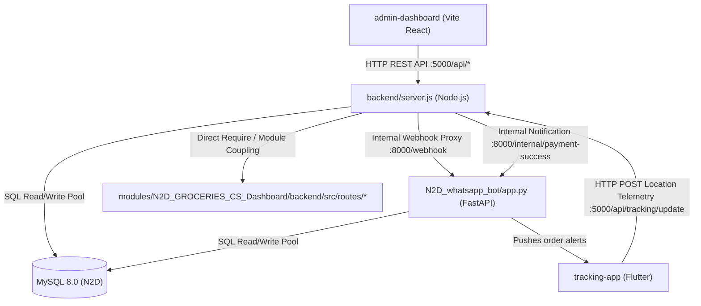

# Need2Done (N2D) — Deployable Service & Module Catalogue

| Document Version | Status | Generated Date | Commit SHA | Classification |
|---|---|---|---|---|
| 1.0.0 | Verified from Repository | 2026-10-02 | `a609e45d0701ce9280eb427c8062d87a28578235` | Organization Confidential |

---

## 1. Overview & Verification Legend

This catalogue contains comprehensive records for every backend service, worker daemon, frontend application, mobile client, reverse proxy, database engine, and subsystem module in the Need2Done (N2D) repository.

- **Confirmed from repository**: Backed by concrete source code, package manifests, build scripts, and configuration files.
- **Inferred from repository**: Logically deduced from code patterns, variable references, and operational conventions.
- **UNVERIFIED — owner/action required**: Absent or unverifiable from repository artifacts alone.

---

## 2. Core Service Records

### 2.1. Service Record: `n2d-backend` (Node.js Express API Server)

- **Service Name**: `n2d-backend`
- **Purpose**: Core RESTful API server handling order lifecycle management, manual bill approval calculations, payment gateway callbacks, customer tracking token generation, live GPS endpoint serving, admin authentication, rate limiting, and webhook forwarding.
- **Repository Path**: `backend/`
- **Status**: Active / Production Ready
- **Runtime / Language / Framework / Version**:
  - Language: JavaScript (Node.js)
  - Runtime: Node.js 20.x (`DEPLOYMENT.md#L75`)
  - Framework: Express.js `^5.2.1` (`backend/package.json#L17`)
- **Entrypoint**: `backend/server.js` (`backend/package.json#L4`)
- **Key Internal Dependencies**:
  - `backend/config/db.js` (MySQL connection pool via `mysql2`)
  - `backend/middleware/auth.js` (JWT token verification)
  - `backend/middleware/rateLimiter.js` (API rate limiting)
  - `backend/middleware/logger.js` (Request logging)
  - `backend/services/olaMapsService.js` (Ola Maps OAuth 2.0 & Routing client)
  - `modules/N2D_GROCERIES_CS_Dashboard/backend/src/routes/*` (Directly mounted grocery subsystem routes)
- **External Dependencies**:
  - `mysql2`: `^3.22.0`
  - `axios`: `^1.7.0`
  - `cors`: `^2.8.6`
  - `dotenv`: `^17.4.2`
  - `multer`: `^2.2.0`
  - `razorpay`: `^2.9.8`
- **Exposed Network Ports**:
  - Listening Port: `5000` (configurable via `process.env.PORT`, defaults to 3000 if unset; `backend/server.js#L426`, `.env.example#L31`)
  - Bound interface: `127.0.0.1` (behind Nginx reverse proxy)
- **Configuration Variables**:
  - `PORT`: Server port (default: 5000)
  - `DB_HOST`, `DB_USER`, `DB_PASSWORD`, `DB_NAME`, `DB_PORT`: MySQL credentials (`backend/config/db.js#L9-L13`)
  - `CORS_ORIGIN`: Allowed origins list (`backend/server.js#L16`)
  - `NODE_ENV`: Environment flag (`production` enforces non-wildcard CORS; `backend/server.js#L19`)
  - `JWT_SECRET`: Admin authentication secret (`backend/middleware/auth.js`)
  - `RAZORPAY_KEY_ID`, `RAZORPAY_KEY_SECRET`: Razorpay API credentials (`backend/routes/payments.js#L7-L8`)
  - `OLA_MAPS_CLIENT_ID`, `OLA_MAPS_CLIENT_SECRET`, `OLA_MAPS_API_KEY`: Routing credentials (`backend/services/olaMapsService.js#L7-L9`)
- **Data Stores & Caches**:
  - Primary Store: MySQL `N2D` database (Connection pool size: 10; `backend/config/db.js#L14`)
  - In-memory cache: Ola Maps OAuth access token (`backend/services/olaMapsService.js#L14-L15`)
- **Queues / Topics**: None (Direct synchronous HTTP requests and database state polling)
- **Authentication & Authorization**:
  - Admin Routes: Bearer token validated via `backend/middleware/auth.js` (JWT signed by `JWT_SECRET`)
  - Webhook Forwarder: Passthrough proxy to Python bot on `http://127.0.0.1:8000/webhook` (`backend/server.js#L64-L96`)
- **Health & Readiness Check**:
  - Endpoint: `GET /api/health` (`backend/server.js#L182-L234`)
  - Probes: Executes `SELECT 1` on MySQL, pings Python bot at `http://127.0.0.1:8000/health`, reports host memory and CPU utilization.
- **Deployable Artifact & Process**:
  - Deployed as a systemd service: `scripts/systemd/need2done-backend.service`
  - Fallback / shell runner: `scripts/start_backend.sh` (executes via `nohup node server.js`)
- **Evidence**: `backend/package.json#L1-L23`, `backend/server.js#L1-L432`, `scripts/systemd/need2done-backend.service`.

---

### 2.2. Service Record: `N2D_whatsapp_bot` (Python Conversational Engine & Auto-Assigner Daemon)

- **Service Name**: `N2D_whatsapp_bot`
- **Purpose**: Conversational state engine for WhatsApp Cloud API, customer intent classification, multi-role dispatching (Customer, Helper, Vendor, Admin), receipt image processing, auto-assigner background daemon, and Home Service timer tasks.
- **Repository Path**: `N2D_whatsapp_bot/`
- **Status**: Active / Production Ready
- **Runtime / Language / Framework / Version**:
  - Language: Python 3.10+ / 3.11+ (`DEPLOYMENT.md#L92`)
  - Framework: FastAPI `0.135.3`, Uvicorn `0.44.0` (`N2D_whatsapp_bot/requirements.txt#L9,L23`)
- **Entrypoint**: `N2D_whatsapp_bot/app.py`
- **Key Internal Dependencies**:
  - `N2D_whatsapp_bot/config.py`: Centralized environment and dynamic pricing loader
  - `N2D_whatsapp_bot/core/role_router.py`: Role demultiplexer
  - `N2D_whatsapp_bot/core/customer_router.py`: Customer conversational state machine
  - `N2D_whatsapp_bot/core/helper_router.py`: Helper response and acceptance handler
  - `N2D_whatsapp_bot/core/admin_router.py`: WhatsApp-based admin actions
  - `N2D_whatsapp_bot/core/vendor_router.py`: Vendor interaction handler
  - `N2D_whatsapp_bot/core/order_finalizer.py`: Payment success and order completion
  - `N2D_whatsapp_bot/auto_assigner.py`: Periodic unassigned order assignment engine
  - `N2D_whatsapp_bot/background_jobs.py`: Home service timer countdown checks
  - `N2D_whatsapp_bot/whatsapp_client.py`: Meta Graph API HTTP caller
  - `N2D_whatsapp_bot/db/mysql_conn.py`: Thread-safe MySQL connection pool
- **External Dependencies**:
  - `fastapi==0.135.3`, `uvicorn==0.44.0`, `pydantic==2.13.0`
  - `mysql-connector-python==9.6.0`
  - `requests==2.33.1`, `urllib3==2.6.3`
  - `python-dotenv==1.2.2`, `Jinja2==3.1.6`
- **Exposed Network Ports**:
  - Listening Port: `8000` (internal loopback only)
- **Configuration Variables**:
  - `WHATSAPP_ACCESS_TOKEN`: Meta Graph API user access token (`config.py#L26`)
  - `WHATSAPP_PHONE_NUMBER_ID`: Meta phone number ID (`config.py#L28`)
  - `WHATSAPP_VERIFY_TOKEN`: Webhook challenge token (`config.py#L30`)
  - `INTERNAL_SECRET`: Shared secret for backend-to-bot internal calls (`config.py#L27`)
  - `ADMIN_PHONE_NUMBER`: Admin mobile number (`config.py#L37`)
  - `HELPER_NUMBERS`: Comma-separated fallback helper list (`config.py#L46`)
  - `HELPER_CHARGE`, `PLATFORM_FEE`, `ANYWORK_BASE_FEE`: Flat fee settings (`config.py#L97-L99`)
  - `ADVANCED_PRICING`: JSON block for vehicle tiers and distance rates (`config.py#L119-L163`)
  - `GOOGLE_MAPS_API_KEY`: API key for geocoding / distance fallback (`config.py#L263`)
- **Data Stores & Caches**:
  - Primary Store: MySQL `N2D` database (Connection pool size: 32; `mysql_conn.py#L39`)
  - In-memory message deduplication: `_PROCESSED_MSG_IDS` (TTL: 60s; `app.py#L135-L154`)
  - In-memory session store: `session_store.py`
- **Background Tasks & Daemons**:
  - Auto-Assigner Daemon: Daemon thread running every 30 seconds (`app.py#L380-L394`, `auto_assigner.py`)
  - Home Service Timer Daemon: Asyncio task checking elapsed booking durations (`app.py#L160-L166`, `background_jobs.py`)
- **Authentication & Authorization**:
  - Meta Webhook GET: Token challenge verified against `VERIFY_TOKEN` (`app.py#L170-L174`)
  - Meta Webhook POST: Open HTTP endpoint forwarded by Node backend
  - Internal Endpoints: Validated via `X-INTERNAL-SECRET` header (`app.py#L127-L129,L367`)
- **Health & Readiness Check**:
  - Endpoint: `GET /health` (`app.py#L248-L250`)
  - Response: `{"status": "Need2Done Bot Active"}`
- **Deployable Artifact & Process**:
  - Deployed as a systemd service: `scripts/systemd/need2done-bot.service`
  - Fallback / shell runner: `scripts/start_bot.sh` (executes via `nohup uvicorn app:app --port 8000`)
- **Evidence**: `N2D_whatsapp_bot/app.py#L1-L395`, `N2D_whatsapp_bot/requirements.txt#L1-L24`, `scripts/systemd/need2done-bot.service`.

---

### 2.3. Service Record: `admin-dashboard` (React Vite Operations Console)

- **Service Name**: `admin-dashboard`
- **Purpose**: Operational management single-page application (SPA) for operations staff, dispatchers, and administrators to monitor live helper GPS coordinates, verify store receipts, approve bill amounts, toggle vertical availability, manage driver wallets, and review revenue analytics.
- **Repository Path**: `admin-dashboard/`
- **Status**: Active / Production Ready
- **Runtime / Language / Framework / Version**:
  - Language: JavaScript (JSX)
  - UI Library: React `^19.2.4` (`admin-dashboard/package.json#L16`)
  - Build Tool: Vite `^8.0.4` (`admin-dashboard/package.json#L35`)
  - Styling: TailwindCSS `^3.4.19` (`admin-dashboard/package.json#L34`)
  - Routing: React-Router-DOM `^7.14.1` (`admin-dashboard/package.json#L19`)
  - Maps: Leaflet `^1.9.4`, React-Leaflet `^5.0.0` (`admin-dashboard/package.json#L14,L18`)
- **Entrypoint**: `admin-dashboard/src/main.jsx`
- **Key Modules & Pages**:
  - `src/pages/Dashboard.jsx`: Live order stream and KPI metrics
  - `src/pages/LiveMap.jsx`: Real-time Leaflet map displaying helper positions
  - `src/pages/Helpers.jsx`: Agent onboarding and active status toggling
  - `src/pages/TrackingStatus.jsx`: Deep order tracking timeline inspector
  - `src/pages/Wallet.jsx`: Helper ledger credits, debits, and balance recharges
  - `src/pages/Services.jsx`: Platform service toggles (Groceries, Food, Rides, etc.)
  - `src/pages/Settings.jsx`: System variables, pricing tiers, and credentials
  - `src/pages/Health.jsx`: Infrastructure and monitoring dashboard
- **Configuration Variables**:
  - `VITE_API_URL`: Backend API root (`admin-dashboard/src/config.js#L5-L7`)
  - `VITE_GOOGLE_MAPS_API_KEY`: Maps client key fallback (`admin-dashboard/src/config.js#L9`)
- **Deployable Artifact & Build Output**:
  - Static distribution build directory: `admin-dashboard/dist/`
  - Build command: `npm run build` (via `scripts/start_dashboard.sh`)
  - Served by Nginx at route `/admin` (`nginx/need2done.conf#L167-L170`)
- **Evidence**: `admin-dashboard/package.json#L1-L38`, `admin-dashboard/src/App.jsx#L1-L401`, `nginx/need2done.conf#L167-L170`.

---

### 2.4. Service Record: `tracking-app` (Flutter Helper Agent Mobile App)

- **Service Name**: `tracking-app` (App Title: `Need2done Agent`, Package: `n2d_tracking`)
- **Purpose**: Mobile client application used by field delivery helpers. Runs foreground and background geolocation tracking tasks to stream high-precision GPS coordinates back to the platform during active orders, provides routing maps, and handles order dispatch deep links.
- **Repository Path**: `tracking-app/`
- **Status**: Active / Production Ready
- **Runtime / Language / Framework / Version**:
  - Language: Dart (SDK `>=3.2.0 <4.0.0`)
  - Framework: Flutter SDK (`tracking-app/pubspec.yaml#L7-L12`)
- **Entrypoints**:
  - UI Main: `tracking-app/lib/main.dart`
  - Background Service Task Handler: `tracking-app/lib/tracking_service.dart#L19-L21` (`startCallback`)
- **Key Dependencies**:
  - `flutter_foreground_task`: `^9.2.2` (Background execution on Android)
  - `geolocator`: `^14.0.2` (GPS position acquisition)
  - `flutter_map`: `^7.0.2` & `latlong2`: `^0.9.1` (Interactive map rendering via OpenStreetMap)
  - `app_links`: `^6.4.0` (Deep link handling: `n2d://track?order_id=X&helper_code=Y`)
  - `flutter_dotenv`: `^5.2.1` (Runtime `.env` asset loading)
  - `http`: `^1.6.0` (REST HTTP communication)
- **Target Operating Systems**:
  - Android (min_sdk 21, adaptive icons, background location permissions)
  - iOS (configured in `pubspec.yaml`, plist entries for location)
- **External Endpoints Consumed**:
  - Ingestion endpoint: `POST https://need2done.in/api/tracking/update` (`tracking_service.dart#L14-L15,L55-L59`)
  - Tile Server: `https://tile.openstreetmap.org/{z}/{x}/{y}.png`
- **Configuration Variables**:
  - `TRACKING_API_URL`: Target URL for location telemetry
- **Deployable Artifact**:
  - Android APK: `website/apk/` (packaged release APK for helper distribution)
- **Evidence**: `tracking-app/pubspec.yaml#L1-L62`, `tracking-app/lib/main.dart#L1-L100`, `tracking-app/lib/tracking_service.dart#L1-L83`.

---

### 2.5. Service Record: `nginx-gateway` (Nginx Reverse Proxy & SSL Gateway)

- **Service Name**: `nginx-gateway`
- **Purpose**: Internet-facing reverse proxy, SSL termination engine, static SPA server, security header enforcement, and URL routing gateway.
- **Repository Path**: `nginx/`
- **Status**: Active / Production Ready
- **Runtime / Version**: Nginx 1.18+ on Ubuntu 22.04 LTS
- **Entrypoint Configuration**: `/etc/nginx/sites-available/need2done` (mirrored at `nginx/need2done.conf`)
- **Routing Rules**:
  - `location /webhook`: Proxied to Node backend at `http://127.0.0.1:5000/webhook` (`nginx/need2done.conf#L96-L107`)
  - `location /api/`: Proxied to Node backend at `http://127.0.0.1:5000/api/` (`nginx/need2done.conf#L114-L130`)
  - `location /track/`: Proxied to Node backend at `http://127.0.0.1:5000/track/` (`nginx/need2done.conf#L137-L144`)
  - `location /open-app`: Proxied to Node backend deep link redirector (`nginx/need2done.conf#L150-L157`)
  - `location /status` & `/dashboard`: Proxied to Uptime Kuma monitoring at `http://127.0.0.1:3001` (`nginx/need2done.conf#L207-L238`)
  - `location /socket.io/`: Proxied with WebSocket upgrade headers to Uptime Kuma (`nginx/need2done.conf#L240-L249`)
  - `location /admin`: Served from `/need2done/app/Need2Done/website` or `/admin-dashboard/dist`
  - `location /food`, `/vegetables-fruits`, `/groceries`, `/home-services`: Served as static micro-frontends from `/website`
  - `location /`: Served from `/need2done/app/Need2Done/website/` (Landing marketing page)
  - `location /uploads/`: Served directly from `/need2done/app/Need2Done/backend/public/uploads/`
- **Security Headers Injected**:
  - `X-Frame-Options: SAMEORIGIN`
  - `X-Content-Type-Options: nosniff`
  - `X-XSS-Protection: 1; mode=block`
  - `Referrer-Policy: strict-origin-when-cross-origin`
  - `Strict-Transport-Security: max-age=31536000; includeSubDomains`
  - `Content-Security-Policy`: Specified default and script policies
- **Evidence**: `nginx/need2done.conf#L1-L294`.

---

### 2.6. Service Record: `uptime-kuma` (Synthetic Observability Service)

- **Service Name**: `uptime-kuma`
- **Purpose**: Self-hosted synthetic monitoring and alerting daemon. Continually checks HTTP status, SSL certificate expirations, internal loopback ports, and upstream partner availability.
- **Repository Path**: `docker-compose.monitoring.yml`, `scripts/`
- **Status**: Active / Production Ready
- **Runtime / Image**: Docker container `louislam/uptime-kuma:1` (`docker-compose.monitoring.yml#L5`)
- **Network Ports**:
  - Bound Port: `127.0.0.1:3001` (internal loopback; proxied by Nginx to `https://need2done.in/status`)
- **Persistent Storage**: Docker volume `uptime-kuma-data` mounted at `/app/data` (`docker-compose.monitoring.yml#L11`)
- **Configured Probes (14 Monitors)**:
  - HTTPS Domain & SSL: `https://need2done.in` (15-day SSL expiry threshold)
  - Node API: `http://127.0.0.1:5000/api/health`
  - WhatsApp Bot: `http://127.0.0.1:8000/health`
  - MySQL Engine: TCP port `3306`
  - Nginx Proxy: TCP port `80`
  - Meta Graph API: `https://graph.facebook.com/v19.0/me`
  - Ola Maps Token API: `https://account.olamaps.io/...`
  - Razorpay Orders API: `https://api.razorpay.com/v1/orders`
  - Orders Subsystem: `http://127.0.0.1:5000/api/orders`
  - Helpers Subsystem: `http://127.0.0.1:5000/api/helpers`
  - Produce API: `http://127.0.0.1:5000/api/fruits-vegetables`
  - Groceries API: `http://127.0.0.1:5000/api/groceries/categories`
  - Home Services API: `http://127.0.0.1:5000/api/home-services`
  - Ride API: `http://127.0.0.1:5000/api/ride`
- **Notification Channels**: Telegram Bot Incident Alerts (`scripts/setup_telegram_alert.js`)
- **Evidence**: `docker-compose.monitoring.yml#L1-L18`, `scripts/n2d_monitors_config.json#L1-L116`, `scripts/setup_uptime_kuma.sh`.

---

### 2.7. Service Record: `n2d-mysql` (Relational Database Engine)

- **Service Name**: `n2d-mysql`
- **Purpose**: Primary relational persistence engine storing customer accounts, helper profiles, orders, state transitions, GPS breadcrumbs, tokens, pricing tiers, and vendor records.
- **Repository Path**: `docs/AWS/schema_live_full.sql`, `backend/db/`
- **Status**: Active / Production Ready
- **Runtime / Version**: MySQL Server 8.0 (`DEPLOYMENT.md#L81`)
- **Network Ports**:
  - Bound Port: `127.0.0.1:3306` (strictly non-public; internal loopback only)
- **Database Name**: `N2D` (Character set: `utf8mb4`, Collation: `utf8mb4_unicode_ci`)
- **User / Access Control**: Dedicated database user `n2d_user` (`DEPLOYMENT.md#L112`)
- **Key Tables**: `orders`, `customers`, `helpers`, `helper_status`, `helper_live_tracking`, `helper_location_history`, `order_images`, `order_items`, `order_rides`, `order_tasks`, `order_timeline`, `order_tracking_tokens`, `products`, `cart_items`, `service_config`, `helper_ledger`, `vendors`, `support_requests`, `admins`.
- **Evidence**: `docs/AWS/schema_live_full.sql#L1-L364`, `backend/db/schema_v2.sql#L1-L237`, `DEPLOYMENT.md#L101-L120`.

---

## 3. Subsystem Modules & Frontends Catalogue

| Module Name | Repository Path | Type | Production URL / Route | Technology Stack | Status |
|---|---|---|---|---|---|
| **Landing Marketing Site** | `website/` | Static HTML/CSS/JS | `https://need2done.in/` | Vanilla HTML5, CSS3, JavaScript | Confirmed |
| **Food Delivery SPA** | `modules/N2D_FOOD_CS_Dashboard` & `website/food` | React SPA | `https://need2done.in/food` | React, Vite, TailwindCSS | Confirmed |
| **Produce (Fruits & Veggies)** | `modules/N2D_FRUITS_VEGETABLES_Dashboard` & `website/vegetables-fruits` | Next.js Static Export | `https://need2done.in/vegetables-fruits` | Next.js / React static build | Confirmed |
| **Groceries Marketplace** | `modules/N2D_GROCERIES_CS_Dashboard` & `website/groceries` | React SPA + Node APIs | `https://need2done.in/groceries` | React, Node.js routers, Express | Confirmed |
| **Home Services Booking** | `modules/N2D_HOME_SERVICES_CS_Dashboard` & `website/home-services` | React SPA | `https://need2done.in/home-services` | React 18, Vite, Context API | Confirmed |
| **Ride Booking Web View** | `website/ride` | Web App | `https://need2done.in/ride` | Static HTML/JS | Confirmed |
| **Customer Tracking Web View** | `backend/public/tracking/index.html` | Dynamic HTML View | `https://need2done.in/track/:token` | Leaflet.js, OpenStreetMap | Confirmed |

---

## 4. Internal Module Dependency & Coupling Matrix

- **Inbound Calls to `backend/server.js`**:
  - Ingress traffic from Nginx (`/api/*`, `/track/*`, `/webhook`, `/open-app`)
  - Helper location updates from Flutter mobile app (`/api/tracking/update`)
  - Admin operational queries from React dashboard (`/api/orders`, `/api/helpers`, etc.)
- **Outbound Calls from `backend/server.js`**:
  - HTTP proxy calls to Python Bot (`http://127.0.0.1:8000/webhook`, `/internal/payment-success`)
  - HTTP REST calls to Razorpay API (`https://api.razorpay.com/v1/orders`)
  - HTTP REST calls to Ola Maps OAuth and Routing APIs (`https://account.olamaps.io`, `https://api.olamaps.io`)
- **Outbound Calls from `N2D_whatsapp_bot`**:
  - HTTPS calls to Meta Graph API (`https://graph.facebook.com/v19.0/{PHONE_ID}/messages`)
  - Database queries via `mysql-connector-python` connection pool
